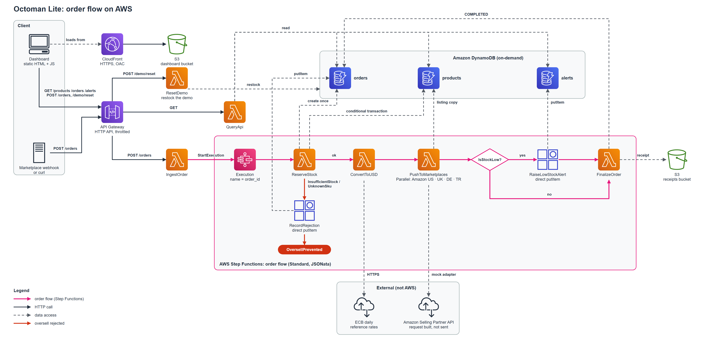
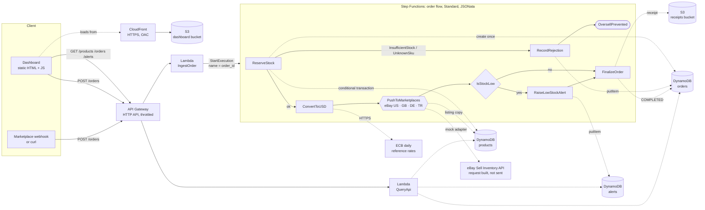

# OctoMan Lite

**Cross-marketplace oversell prevention on a fully serverless AWS stack.**
One order flow, end to end: an order arrives from eBay US, GB, DE or TR, stock
is reserved atomically, the total is converted to USD with ECB reference rates,
the new stock level is pushed to every other eBay site in parallel, a low-stock
alert is raised when needed, and a receipt is saved to S3.

No servers, no CI/CD pipeline. Deployment is `sam build && sam deploy --guided`.

---

## The problem: overselling across channels

A seller lists the same 3 units on eBay US, eBay UK, eBay Germany and eBay Turkey.
Each site believes it has 3 to sell. Two buyers on two sites click "Buy" in the
same second for the last unit, and both orders go through. One of them has to be
cancelled, which costs money, seller rating and sometimes the account.

Avoiding this needs two things:

1. **One source of truth for stock**, decremented atomically, so two orders can
   never both take the last unit.
2. **Fast propagation**: once stock changes, every other marketplace must learn
   the new quantity right away.

OctoMan Lite is a scaled-down, standalone version of OctoMan, a multi-channel
inventory system. It keeps just this one flow so it can be deployed by anyone in
a few minutes.

## What it does

```
POST /orders  {"marketplace": "DE", "sku": "OCTO-LAMP-004", "quantity": 1}
```

1. **IngestOrder** (Lambda) validates the request, prices it from the product's
   eBay DE listing (EUR) and starts a Step Functions execution named after the
   order id. A duplicate order id is refused (HTTP 409).
2. **ReserveStock** (Lambda) runs one DynamoDB transaction: decrement
   `stock_on_hand` **only if** `stock_on_hand >= quantity`, and create the order
   **only if** it does not exist yet. If stock is short, the order is recorded as
   `REJECTED` and the execution ends in the red `OversellPrevented` state.
3. **ConvertToUSD** (Lambda) converts the total with the ECB daily reference
   rates, falling back to built-in rates (and labelling them as such) if the
   feed is unreachable.
4. **PushToMarketplaces** (Parallel state, one branch per eBay site) pushes the
   new quantity through the marketplace adapter. In the default **mock mode** the
   adapter builds the exact eBay Sell Inventory API request
   (`bulk_update_price_quantity`, with the right `X-EBAY-C-MARKETPLACE-ID` and
   `Content-Language`) and returns it without sending it, so no eBay account or
   credentials are needed. The request is visible in the execution graph.
5. **IsStockLow → RaiseLowStockAlert**: if the new stock is below the product's
   threshold, an alert row is written straight from Step Functions to DynamoDB
   (no Lambda).
6. **FinalizeOrder** (Lambda) saves a receipt JSON to S3 and marks the order
   `COMPLETED`.

`GET /products`, `GET /orders` and `GET /alerts` feed a static dashboard served
from S3 through CloudFront. `POST /demo/reset` ("Restock the demo" on the
dashboard) puts the 15 demo products back and clears the order list, so a visitor
never finds the demo sold out.

## Architecture



<sub>Generated by [`docs/architecture.py`](docs/architecture.py) (no dependencies for the SVG; the PNG uses Playwright). Vector version: [`docs/architecture.svg`](docs/architecture.svg).</sub>

<details>
<summary>Mermaid version</summary>



</details>

| Service | Role |
|---|---|
| **API Gateway (HTTP API)** | `POST /orders`, `GET /products`, `GET /orders`, `GET /alerts`, `POST /demo/reset`. CORS limited to the dashboard. Throttled: 10 rps by default, `POST /orders` 1 rps, `POST /demo/reset` 1 rps (burst 2). |
| **AWS Lambda** (Python 3.12, 7 functions + 1 custom resource) | Validation, reservation, FX, marketplace push, receipt, queries, demo reset. No third-party packages. |
| **AWS Step Functions** (Standard, JSONata) | Orchestrates the order flow; Parallel state fans out to the four marketplaces; Catch turns an oversell into a recorded rejection; direct DynamoDB integrations for the two single-write steps. |
| **Amazon DynamoDB** (on-demand) | `products` (single source of truth for stock + per-site listing copy), `orders` (GSI for newest first), `alerts` (one row per SKU). |
| **Amazon S3** | Private receipts bucket (30-day expiry) and private dashboard bucket. |
| **Amazon CloudFront** | HTTPS front door for the dashboard via Origin Access Control; the bucket stays private. |
| **CloudFormation custom resource** | Uploads the dashboard and its `config.js` (API URL) during `sam deploy`, and empties both buckets on `sam delete`. |
| **CloudWatch Logs** | One log group per function, 7-day retention. |

### Why it cannot oversell

The only place that decides "is there enough stock?" is this DynamoDB transaction
in `src/handlers/reserve_stock.py`:

```text
Update products  SET stock_on_hand = stock_on_hand - :qty  ADD stock_version 1
                 IF  attribute_exists(sku) AND stock_on_hand >= :qty
Put    orders    IF  attribute_not_exists(order_id)
```

DynamoDB evaluates the condition and the write as one atomic step, so two orders
racing for the last unit (try **Race: last unit** on the dashboard) cannot both
succeed: one completes, the other is rejected with `requested` vs `available`.
The second condition makes the step idempotent: if Step Functions retries the
task, the order already exists and stock is not decremented again.
`stock_version` lets each marketplace push ignore a stale quantity that arrives
after a newer one.

## Deploy it yourself

**Prerequisites:** an AWS account, [AWS CLI](https://aws.amazon.com/cli/) with
credentials configured, [AWS SAM CLI](https://docs.aws.amazon.com/serverless-application-model/latest/developerguide/install-sam-cli.html)
and Python 3.12. Docker is **not** needed to build or deploy.

> Deploy into a sandbox or personal AWS account, **not one that runs production
> workloads**, and pass `--profile <your-profile>` to every command below. Check
> where a profile points first with `aws sts get-caller-identity --profile <your-profile>`.
> Every resource name starts with `octoman-lite`, so the stack cannot collide with
> anything else, but a separate account keeps billing and blast radius separate.

If your profile uses short-lived credentials (IAM Identity Center or the CLI's
browser sign-in), sign in first and check which account it points at:

```bash
aws login --profile <your-profile>
```

```bash
aws sts get-caller-identity --profile <your-profile>
```

(For IAM Identity Center profiles the sign-in command is `aws sso login --profile <your-profile>`.)
Then build and deploy:

```bash
sam build
sam deploy --guided --profile <your-profile>
```

The guided deploy asks a few questions. The defaults in `samconfig.toml` are fine:

- **Stack Name:** keep `octoman-lite`.
- **AWS Region:** any region where Step Functions, HTTP APIs and Lambda are available (for example `us-east-1` or `eu-central-1`).
- **Parameter Prefix / MarketplaceMode / DefaultLowStockThreshold / ConsoleLinks:** keep the defaults
  (`ConsoleLinks=true` puts the state machine ARN, which contains your account ID, into the dashboard
  config so orders link to their execution graph; set `false` to hide it).
- **"IngestOrderFunction has no authentication. Is this okay?"** and the same for **QueryApiFunction**:
  answer **y**. The demo API is public on purpose and protected by throttling (see the cost note).
- **Confirm changeset:** read it, then answer **y**.

The first deploy takes about 5 minutes, most of it CloudFront. The outputs include:

- `DashboardUrl`: open this in a browser.
- `ApiUrl`: the HTTP API base URL.

Then load the synthetic products. The seed script runs on your machine and needs
boto3, so install the dev requirements once:

```bash
python -m pip install -r requirements-dev.txt
```

Then seed (pass the region you deployed to):

```bash
python scripts/seed.py --profile <your-profile> --region <region>
```

Open `DashboardUrl` and click a site button. To start over at any time, click
**Restock the demo** on the dashboard, or from the command line:

```bash
python scripts/seed.py --profile <your-profile> --region <region> --reset
```

Both use the same product list (`src/shared/seed_data.py`).

### Try it with curl

```bash
curl -s -X POST "$API_URL/orders" -H "content-type: application/json" -d '{"marketplace":"DE","sku":"OCTO-LAMP-004","quantity":1}'
```

```bash
curl -s "$API_URL/orders?limit=5"
```

A request for more units than are in stock (for example `OCTO-KEY-009` with
`"quantity": 5`) is accepted by the API (HTTP 202) and then rejected by the
workflow. It shows up as `REJECTED` in `GET /orders` and as a red
`OversellPrevented` execution in the Step Functions console.

### Clean up

```bash
sam delete --stack-name octoman-lite --profile <your-profile>
```

The custom resource empties both buckets first, so the delete completes in one go.

### If you leave it running

The stack costs nothing while idle, but the API is public. Throttling caps the
worst case (see [Cost](#cost)); a budget alert tells you if anything unexpected
happens. In the account you deployed to:

1. Open the AWS console, go to **Billing and Cost Management → Budgets**, and choose **Create budget**.
2. Choose **Use a template (simplified)** and the **Monthly cost budget** template.
3. Set **Budgeted amount** to `5.00` USD and give it a name, for example `octoman-lite-demo`.
4. Under **Email recipients**, enter the address that should get the alert.
5. Choose **Create budget**. AWS emails you when actual spend reaches 85% and 100% of the
   amount, and when forecasted spend is expected to exceed 100%.

Creating a budget needs Billing permissions in that account. A plain cost budget
with email alerts like this one is free.

## Verify locally (no AWS account needed)

```bash
python -m pip install -r requirements-dev.txt
```

```bash
python -m pytest -q
```

```bash
sam validate --lint
```

```bash
python scripts/seed.py --dry-run
```

Node.js is optional: if it is installed, pytest also runs the dashboard's
JavaScript unit tests (`tests/js`) with Node's built-in test runner; without it
those two tests are skipped.

The tests run every handler against [moto](https://github.com/getmoto/moto)
(in-memory AWS), check the state machine definition statically, and never touch a
real account. With Docker running, two functions can also be invoked locally
without AWS:

```bash
sam build && sam local invoke ConvertFxFunction -e events/convert_fx.json
```

```bash
sam local invoke IngestOrderFunction -e events/post_order_invalid.json
```

The other functions read or write DynamoDB and S3, so `sam local invoke` on them
needs the deployed stack and credentials (`--profile`).

To look at the dashboard against a deployed API from your machine:
`python -m http.server 8080 -d dashboard`, then open
`http://localhost:8080/index.html?api=<ApiUrl>` (that origin is allowed by CORS).

## Cost

Everything is pay-per-use and **scales to zero**: no instances, no provisioned
capacity, no NAT gateway, no fixed monthly fee. An idle stack costs nothing beyond
a few kilobytes of S3 and DynamoDB storage.

| Per order | Approximate cost |
|---|---|
| Step Functions Standard, ~11 state transitions | $0.000275 |
| 6 Lambda invocations, 256 MB, short runs | < $0.00002 |
| DynamoDB on-demand, ~10 reads/writes | < $0.00002 |
| S3 receipt PUT | $0.000005 |

A full demo of a few hundred orders costs cents, and less if your account still
has Free Tier allowances for Lambda and Step Functions.

**Worst case if the API URL leaks:** `POST /orders` is throttled to 1 request per
second, so the most it can run is ~86,000 orders a day, roughly **$25/day**,
almost all of it Step Functions transitions. `POST /demo/reset` is capped at 1
request per second; each reset is a few hundred DynamoDB writes at most (about
$0.0003). Run `sam delete` when you are done.

## Reuse the pattern

The template is one flat file meant to be copied. Pieces that transfer to other
projects:

- **Atomic "check and decrement" with idempotency** in a single
  `TransactWriteItems` (inventory, seat booking, quota, coupon redemption).
- **Execution name = business id** (`StartExecution name=order_id`) gives
  duplicate protection for free.
- **Catch a business error and route it** to a recorded outcome plus a `Fail`
  state, so the console graph shows where and why a request was stopped.
- **Parallel fan-out** with one branch per downstream system, where a failing
  branch reports `status: error` instead of failing the whole request.
- **Direct service integrations** (`arn:aws:states:::dynamodb:putItem`) for
  single writes; Lambda only where there is logic.
- **JSONata** (`"QueryLanguage": "JSONata"` plus `Assign` variables) instead of
  `ResultPath` plumbing.
- **`DefinitionSubstitutions`** to keep the ASL in its own file, readable and
  testable.
- **A static site with zero extra deploy steps**: private S3 + CloudFront OAC,
  plus a custom resource that uploads the files and writes `config.js` with the
  API URL. It re-runs whenever the files change (`AutoPublishAlias` +
  `!Ref Function.Version`) and empties buckets on delete.
- **A `Prefix` parameter with an `AllowedPattern`** so the stack's physical
  names can never collide with another environment.
- **Inline, per-function IAM statements** instead of broad policy templates.

## Design notes and production considerations

- **Mock adapter.** `MARKETPLACE_MODE=mock` (the default) keeps the same adapter
  interface OctoMan uses for eBay, so a live adapter is a drop-in replacement.
  Live mode is intentionally not available here: it needs OAuth tokens per
  seller, which belong in a token store this demo does not include.
- **Order of steps.** FX conversion runs before the marketplace push, as
  specified. In production, pushing first would shorten the window in which
  another site can still sell the item (by up to the FX timeout of 3 s).
- **The marketplace is the origin of truth for its own sale.** The site that sold
  the item already decremented its listing, so its branch only updates the local
  copy (`status: skipped`).
- **Single tenant.** OctoMan is multi-tenant (Cognito, per-tenant keys); Lite uses
  one synthetic tenant. The orders GSI uses a constant partition key, which is
  fine for a demo and would be partitioned by tenant in production.
- **Public API.** There is no authentication on purpose, so judges can use it
  without signing in. Throttling caps abuse and cost. A real deployment would put
  an authorizer (JWT/IAM) on the routes and verify marketplace webhook signatures.
  The public reset route can only touch the three demo tables (its IAM allows
  `BatchWriteItem` on them and `Scan` on orders and alerts, nothing else).
- **Reset while an order is running.** Every reset restarts the stock versions at
  the current time, so a marketplace push from an order that started before the
  reset cannot overwrite the restored quantities. Such an order may still fail at
  its last step (its order row was cleared); that is accepted for a demo reset.
- **Rejected orders end in a `Fail` state.** That is a deliberate demo choice; a
  production workflow might end in `Succeed` with a status instead and alarm on
  real failures only.

## Project layout

```
template.yaml                    the whole stack (SAM)
samconfig.toml                   deploy defaults (stack name octoman-lite)
statemachine/order_flow.asl.json order workflow (JSONata)
src/handlers/                    Lambda entry points
src/shared/                      db helpers, ECB FX, validation, config, seed data
src/shared/adapters/             eBay adapter (mock by default)
dashboard/index.html             static dashboard
dashboard/deployer.py            custom resource that publishes it
scripts/seed.py                  15 synthetic products
events/                          sample events for sam local invoke
tests/                           pytest + moto, no AWS needed
docs/demo_script.md              2.5 minute demo script
```

All product names, offer ids and prices are synthetic. The repository contains no
credentials, API keys or customer data.
