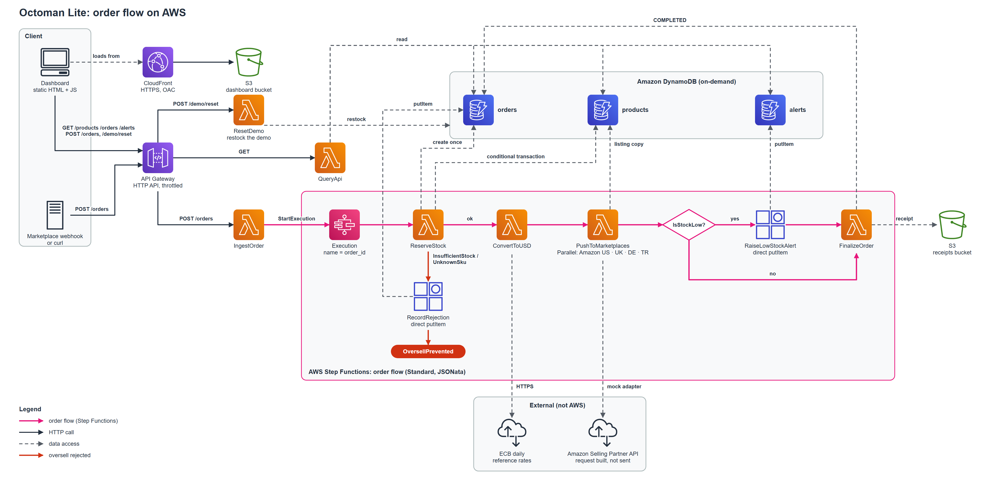

<!--
NOTE FOR THE AUTHOR (delete this block before posting):
- Check the title prefix, required tags and any minimum length against the
  challenge page before posting; they were not confirmed when this was drafted.
- Replace <LIVE_DEMO_URL> and <VIDEO_URL>.
- The last line of "Try it" (AI assistant disclosure) is optional: keep or delete.
- Article body is about 880 words (between the title and the form-field blurbs).
-->

# Weekend Challenge: OctoMan Lite, one shelf of stock on four Amazon stores without overselling

## The problem

If you sell the same product in several online stores, each store keeps its own
idea of how many you have. When only one unit is left, two customers in two
different countries can both buy it in the same second, and one of those orders
has to be cancelled. That is overselling, and it costs money and seller rating.

## What it does

OctoMan Lite is a small, standalone version of OctoMan, the inventory tool I
am building. It keeps one shared stock level (the "shelf") for four Amazon
stores: the US, the UK, Germany and Türkiye. Every order checks the shelf
first, so the last unit can only be sold once.

The dashboard shows the shelf in the middle and the four stores around it. A
"Try the demo" panel runs four short stories:

- **A customer in Germany buys one.** The shelf drops by one and all four
  stores update, one after another.
- **Sell until stock runs low.** One order takes a product below its warning
  level and a low-stock warning appears.
- **Two customers, one last item.** Two stores order the last unit at the same
  moment. One order is sold, the other is blocked.
- **Someone orders more than we have.** The order is blocked before anything
  is sold.

A six-step strip shows where each order is, or where it was stopped. "Restock
the demo" puts every product back. All products and orders are made-up data.

## How it works

1. **Order arrives:** API Gateway (HTTP API) calls a Lambda function that checks
   the order and starts a Step Functions workflow. Its name is the
   order id, so an order cannot run twice.
2. **Check the shelf:** a Lambda function runs one DynamoDB transaction that
   takes the units off the shelf and records the order.
3. **Convert to dollars:** a Lambda function converts the local price to US
   dollars with the European Central Bank's daily reference rates.
4. **Update all 4 stores:** a Step Functions Parallel state pushes the new
   quantity to the four stores at the same time. The marketplace calls are
   mock: the adapter builds the real Amazon Selling Partner API request (a
   Listings Items PATCH) but never sends it, so no seller account or
   credentials are involved.
5. **Low-stock warning:** if stock falls below the product's warning level,
   Step Functions writes a warning straight to DynamoDB, no Lambda needed.
6. **Save receipt:** a Lambda function stores a receipt JSON in S3 and marks
   the order as sold.

## Why it cannot oversell

"Is there enough?" and "take it off the shelf" happen in a single conditional
DynamoDB transaction: decrease the stock only if it is at least the ordered
quantity, and create the order only if it does not exist yet. DynamoDB applies
both or neither, so two orders can never both take the last unit. When the
condition fails, the workflow records the order as blocked and ends in a red
`OversellPrevented` state, so the execution graph shows exactly where it was
stopped.

On the deployed stack: a Germany order for one mug at €11.99 was converted to
$13.25 at the ECB rate, and all four stores were updated after each sale. When
two stores ordered the last print at the same moment, one was sold and one was
blocked. An order for five keychains with three in stock was blocked.

## No pipeline

The whole system is one AWS SAM template. Deploying is `sam build` and then
`sam deploy`. There is no CI/CD and no separate upload step for the website: a
CloudFormation custom resource publishes the dashboard files and writes its
config (the API address) during the deploy, and empties the buckets on
`sam delete`.

## Cost and scale to zero

Everything is pay-per-use: Lambda, Step Functions, DynamoDB on demand, S3,
CloudFront and API Gateway. There are no servers, so an idle stack costs
nothing beyond a few kilobytes of storage. One order costs about $0.0003, most
of it the roughly 11 Step Functions state transitions. Because the demo API is
public, the order route is throttled to one request per second, which caps the
worst case at roughly $25 a day.

## What I learned

- **JSONata in Step Functions removes a lot of plumbing.** With `Assign`
  variables, each step reads `$order` or `$stock` directly instead of passing
  data through `ResultPath` and `OutputPath`. Parsing the error of a blocked
  order became a one-line expression.
- **A reset needs a version guard.** Each stock change carries a version number,
  and a store's quantity is only written if the version is newer. After
  "Restock the demo" the versions restart from the current time in
  milliseconds, so a late update from an order that was still running cannot
  overwrite the fresh stock.
- **A private bucket is enough for a public site.** CloudFront with Origin
  Access Control serves the dashboard while the S3 bucket stays fully private;
  only that distribution can read it.

## Try it

- Live demo: <LIVE_DEMO_URL> (open "Try the demo" in the bottom-right corner)
- Source and setup guide: https://github.com/anxious956/octoman-lite-hackathon
- Video (under 3 minutes): <VIDEO_URL>

The repository has 165 automated tests that need no AWS account, and a deploy guide.

*Optional:* I built this with the help of an AI coding assistant.

---

## Form fields

**Problem** (≤ 80 words)

Sellers list the same stock on several marketplaces, and each one keeps its own
count. When one unit is left, two customers in different countries can buy it
at the same moment, and one order has to be cancelled. OctoMan Lite keeps one
shared stock level for four Amazon stores (US, UK, Germany, Türkiye) and checks
it in a single atomic step before any sale, so the last unit can only be sold once.

**Services used** (≤ 80 words)

AWS Lambda (Python 3.12), AWS Step Functions (Standard, JSONata, Parallel
state), Amazon DynamoDB (on-demand, conditional transactions), Amazon API
Gateway (HTTP API with throttling), Amazon S3 (receipts and the dashboard),
Amazon CloudFront (Origin Access Control), AWS CloudFormation custom resource
(publishes the dashboard), Amazon CloudWatch Logs. Deployed with one AWS SAM
template using `sam build` and `sam deploy`, no pipeline.

**Architecture** (≤ 80 words)

An HTTP API sends each order to a Lambda that starts a Step Functions workflow
named after the order. One conditional DynamoDB transaction reserves the stock
or blocks the order. Then a Lambda converts the total to US dollars, a Parallel
state updates four mock Amazon stores at once, a low-stock warning is written
directly to DynamoDB, and a receipt goes to S3. A static dashboard on S3 and
CloudFront reads the same API.

## Screenshots to attach

1. The dashboard with the shared shelf and the four Amazon stores around it,
   right after a sale (all four stores showing the new number).
2. A blocked order: the step strip stopped at "Check the shelf" in red with
   "Nobody was oversold", and the red-edged entry in Live orders.
3. The Step Functions execution graph of a sale, with the four parallel
   "Push Amazon" branches, and of a blocked order ending in `OversellPrevented`.
4. The "Technical details" section with the step-to-AWS-service table.
